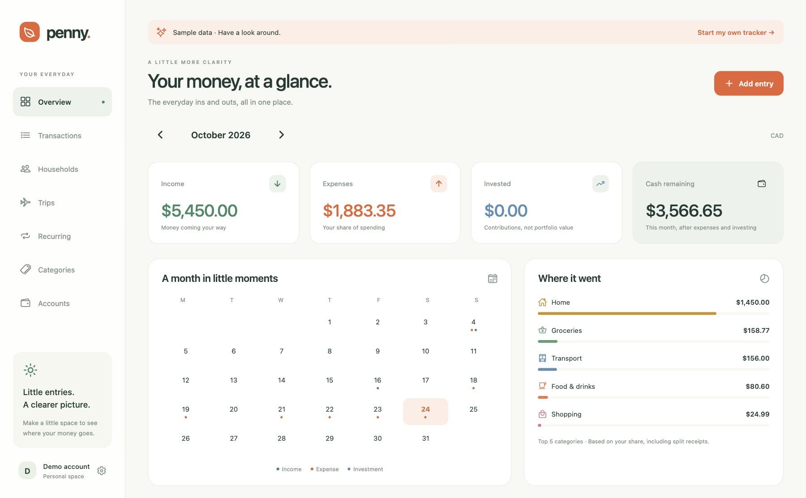
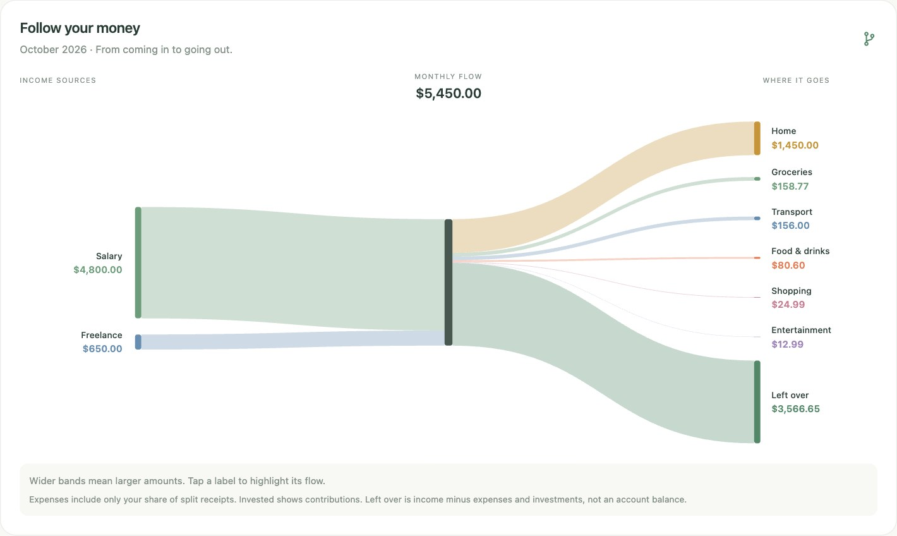
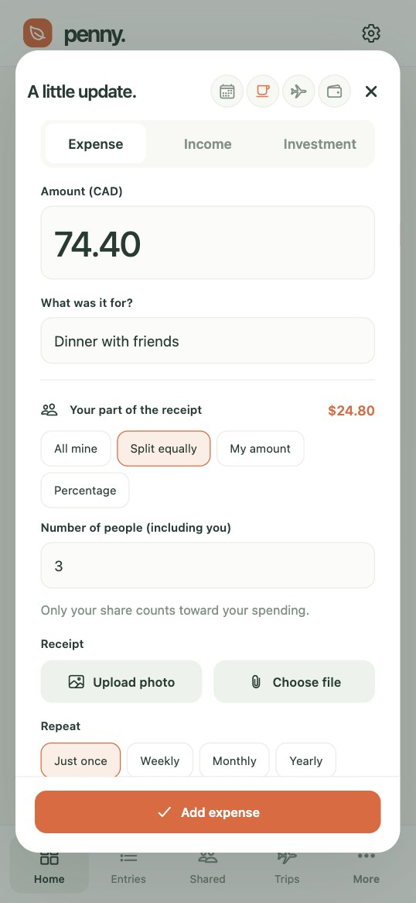

# Penny

A little more clarity about your money. Track expenses, income, and investment contributions on **iOS, Android, and web**, with a self-hosted server that keeps your devices in sync.

[Try it locally](docs/development.md#run-the-complete-web-app) · [Self-host Penny](docs/deployment.md) · [Documentation](docs/README.md)

## Your month, at a glance

See what came in, what you spent, what you invested, and what's left for the month. Explore your calendar and category breakdown, then search and filter individual transactions.

## Follow your money

An interactive flow diagram connects income to spending and money left over. Split expenses count only your share, so the picture reflects your spending—not the whole bill.

## Add it, split it, keep the receipt

Record an expense, income, or investment contribution. Split a bill equally, by amount, or by percentage; attach a photo or PDF; and make regular entries recurring.

*Screenshots use demo data in the web app. The entry form shows the phone-width web layout.*

## Personal finances, shared plans

- **Households and trips:** record shared expenses once, keep personal shares in your reports, and track balances and reimbursements.
- **Your own organization:** customize categories and track payment accounts without connecting a bank.
- **Across your devices:** save personal ledger changes offline and sync when reconnected. Shared actions and receipt uploads need a connection.
- **A low-commitment look around:** choose **Take a look around with sample data** on the sign-in screen. The demo is temporary and needs no account.

Penny tracks investment contributions, not portfolio performance. It is not a bank-connected account-balance tracker. See [app behavior and current limits](docs/app-guide.md) for the details.

## Run it or build on it

Start with [local setup](docs/development.md) or [self-hosting](docs/deployment.md). For architecture, testing, configuration, and mobile releases, head to the [technical documentation](docs/README.md).
