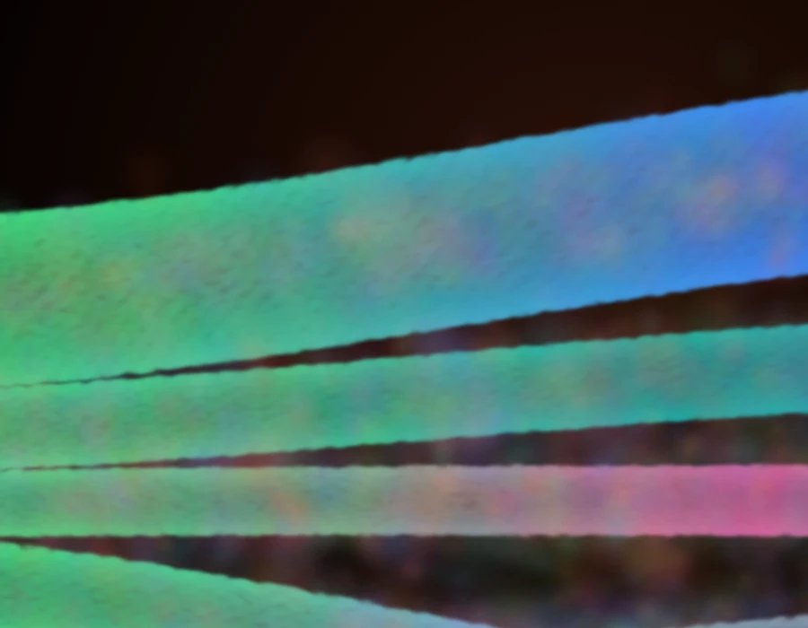

# Product page redesign

Status: **proposal for the owner's review.** No code changes yet. Once approved, the page (`apps/site`) is rebuilt to these cards.

Today's page gives each idea a full screen of its own: seven sections of exactly one screen height, one device per section, with the copy and the device each using about half the width. The page feels empty, and the splat scenes around every device look grainy up close. The ideas stay. The layout gets denser, the product leads, and the splats get fewer and better.

| Card | Preview |
| --- | --- |
| [Desktop, 1440 px](cards/desktop.html) | [previews/desktop.jpg](previews/desktop.jpg) |
| [Phone, 390 px](cards/phone.html) | [previews/phone.jpg](previews/phone.jpg) |

Render them with `node apps/site/docs/design/render.ts` (Playwright from `apps/web`). Blue numbered notes in the cards are review annotations, not design. The dashed line marks the first screen.

Decided with the owner (2026-11-25): keep the splats, but fewer and sharper; hero, showcase and bento instead of one screen per feature; the graininess shows on every device.

## Direction

1. **Show the product above the fold.** The top of the showcase (browser and phone) is visible on the first screen at 1440 × 900 and on a 390 × 844 phone. Nobody has to scroll to see Penny.
2. **Density over drama.** Sections size to their content instead of `min-height: 100vh`. About 120 px between sections on desktop and 72 px on phones. A visitor sees two or three ideas per screen, not one.
3. **Real screens, cropped to what matters.** Feature tiles show the part of a screen that proves the point (Left to spend, the split controls, the calendar), bleeding off the tile's edge, instead of a whole device per feature.
4. **Two splat moments, both excellent.** The coin in the hero and the money-flow ribbons behind the showcase. Nothing else is a splat. Each must meet the [quality bar](#splat-quality-bar).
5. **Same tokens as the apps.** Copper is the one action colour. Green, indigo and the category colours keep their meanings, so a tile's glow takes its feature's colour (green for households, indigo for receipts). Inter, the apps' Ionicons and the page's existing dark surfaces.

## Layout

- **Grid:** 1200 px content width with 24 px margins at least. The bento uses 12 columns with a 16 px gap on desktop, 2 columns with a 12 px gap on phones.
- **Type:** H1 72 px / 0.98 (phone 44 px), H2 48 px / 1.02 (phone 34 px), tile titles 21 px semibold, body 15 to 19 px in the secondary label colour. Tracking −0.045 em on H1, −0.04 em on H2.
- **Tiles:** 24 px radius, a 1 px hairline edge (8 % white), a faint top-left sheen, and a bottom glow in the feature's colour. Screens inside sit on a 28 px top radius and bleed off the bottom edge.
- **Motion:** only the clips and the two splat scenes move. No scroll-jacking. The splats no longer morph between sections.

## Sections

1. **Nav** (sticky, glass): logo; Features, Self-host, Docs; GitHub as the one filled button. On phones, the links fold into a menu button.
2. **Hero:** eyebrow, H1 "A little more clarity about your money.", the lede, *Self-host Penny* and *View the source*, then the three chips. The coin (splat 1) sits to the right at about 440 px on desktop, and above the headline at about 230 px on phones.
3. **Showcase:** the web app in a 1000 px browser frame playing the Insights clip, and the iPhone overlapping its lower right corner playing the Overview clip. The ribbons (splat 2) stream from behind the frames. Below: the clip's captions (HTML, from the clips work) and two chips. On phones the iPhone leads, centred, with the browser dimmed behind it.
4. **Features:** H2 "Everything a month needs. Nothing it doesn't." with a one-line summary, then the bento:

   | Tile | Size (desktop columns) | Content |
   | --- | --- | --- |
   | Left to spend, first | 5, two rows | iPhone home, top half. Overview clip |
   | Split it the way you paid | 7 | The split controls. Entries clip |
   | Receipts, encrypted | 4 | The receipt inbox |
   | Search everything | 3 | A small search with two results (HTML, not a screenshot). The Apps clip is an option here |
   | Households and trips | 7 | The household and trip screens side by side |
   | Recurring, previewed | 5 | The calendar with scheduled dots |
   | On your Home Screen | 6 | The widgets |
   | Face ID lock, Offline-first, Your sign-in | 2 each | Icon, title, one line |

   On phones, the large tiles stack at full width and the small ones pair up in two columns.
5. **Principles:** three columns separated by hairlines. *Your server, your data*, *No bank connection*, *Open source, MIT*.
6. **Self-host:** "Running in a few minutes." with three numbered steps and the two buttons, beside the terminal.
7. **Closing:** one line ("A little more clarity, on your own server.") and the two calls to action, over a soft copper glow. Then the footer note.

## Splat quality bar

Today, up close (captured from the live page at 2×):

What makes them look cheap:

- **Noisy surfaces.** Thousands of small splats, each lit by its own jittered normal, add up to colour and brightness noise on what should be smooth metal and smooth bands.
- **Ragged edges.** The leaf, the rim and the ribbon edges are built from small splats at the boundary, so the silhouette frays instead of reading as a clean edge.
- **Confetti dust.** The dust is many tiny, bright, hard points around the coin.
- **Resolution drops.** The canvas steps down from the device's pixel ratio after a run of slow frames (`src/main.ts`), which turns everything soft and pixelated on weaker GPUs.
- **Scale.** Seven scenes × 160 000 splats, sorted every frame, for scenes that mostly sit behind screenshots.

The bar, for both scenes, checked on 2× captures at 100 % zoom:

1. **No visible individual splats** on a surface. The coin's face reads as polished copper with a smooth highlight; the ribbons as smooth glowing bands with a soft gradient across their width.
2. **Clean silhouettes.** The leaf is in relief with a crisp edge, and the rim and the band edges are continuous, with only a soft falloff.
3. **Dust is atmosphere.** Fewer, softer, larger motes at low opacity, mostly out of focus. It never competes with the coin.
4. **Full resolution, always.** Render at the device's pixel ratio (up to 2). Under load, drop splats or pause, never canvas resolution.
5. **Only while visible.** Each scene renders only while it's on screen, and stops when the tab is hidden. Reduced motion shows a still frame of each scene.
6. **Budget.** 60 fps on an M1 MacBook Air and an iPhone 12. Coin and ribbons only: about 100 000 splats on desktop and 40 000 on phones.

The likely fixes, to confirm when implementing:

- Larger, flatter splats aligned to the surface, with normals that come from the shape rather than from per-splat jitter.
- Edge splats placed exactly on the silhouette, plus a thin edge pass for the leaf and the rim.
- Fewer, bigger dust motes with depth-of-field blur.
- No canvas downscaling, and two scenes instead of seven.

If the live renderer still can't meet the bar on phones, the fallback is a pre-rendered loop of the same scene, which the owner approves separately.

## The clips

The redesign uses all four clips from the clips work: Insights and Overview in the showcase, Overview and Entries in their tiles, and Apps optionally in the Search tile. Captions stay HTML. The pause button, the lazy loading and the reduced-motion and Save-Data fallbacks don't change.

## What changes in the code (after approval)

- `index.html` and `src/styles.css`: the new sections, the bento and the tokens above. No `min-height: 100vh` sections.
- `src/choreography.ts` and the morphing go away: two fixed scenes, each tied to its own canvas or box.
- `src/scenes`: keep `coin` and `flow`, rework both to the quality bar, and drop `nebula`, `rings`, `papers`, `loop` and `trio`.
- `src/clips.ts`: unchanged, with new slots for the tiles.
- `README.md`: the new section table and the splat budget.

## Open questions for the owner

1. **Docs link in the nav:** point it at `docs/README.md` on GitHub, or leave it out?
2. **Search tile:** a static mock (as drawn) or the Apps clip cropped to the search field?
3. **A demo link:** the web demo runs on any Penny server. Is there a public instance to link as *Try the demo*? None is drawn.
