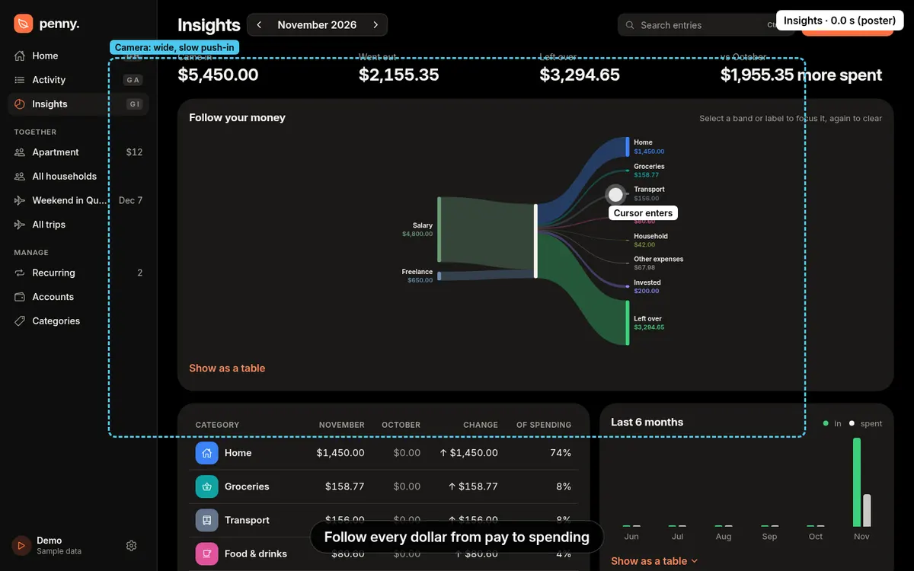
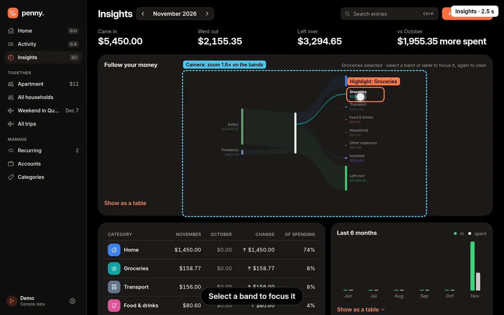
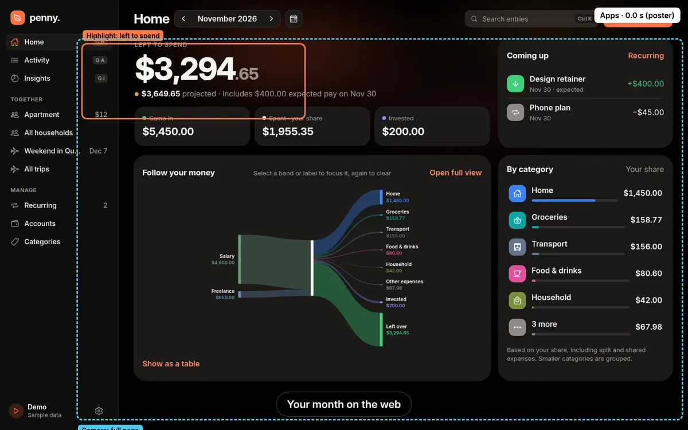
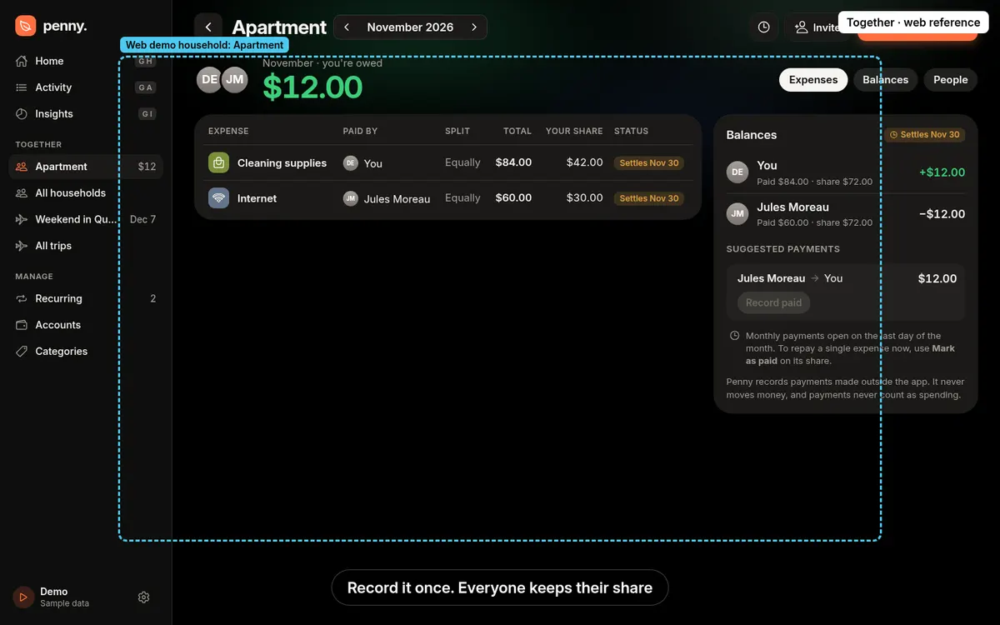

# Product videos: licenses, storyboard and pipeline

Status: **approved by the owner on 2026-11-25**, with the changes recorded under [Decisions](#decisions-2026-11-25). This was step 1 of the "apps in motion" work: the license check, the storyboard and the pipeline outline. Phase 1 (the pipeline, the two web clips and the page wiring) is built: [apps/site/README.md](../README.md#clips-of-the-apps-in-use) is the how-to. The iOS clips follow on the Mac.

The goal is short pre-rendered clips of Penny's real screens, played inside the product page's existing device frames, with the splat scenes still around them. Only synthetic demo data appears: the web demo's sample data and the iOS demo.

## 1. Licenses

Checked on 2026-11-25. This summarises the published terms. It isn't legal advice.

### Remotion: usable for free if Penny's owner is an individual or a company of 3 people or fewer

Sources: [remotion.dev/docs/license](https://www.remotion.dev/docs/license), [LICENSE.md](https://github.com/remotion-dev/remotion/blob/main/LICENSE.md), [pricing](https://www.remotion.dev/docs/license/pricing), [FAQ](https://www.remotion.dev/docs/license/faq).

- **Source-available, not open source.** The FAQ says Remotion is "source-available software, but it is not open source software according to the Open Source Initiative's Open Source Definition".
- **Who uses it for free:** "an individual; a for-profit organization with up to 3 employees; a non-profit or not-for-profit organization; evaluating whether Remotion is a good fit". Headcount is the organisation's total. Free users get every feature.
- **Above that, a Company License:** "Remotion for Creators" at $25 per month per seat for people making videos, and "Remotion for Automators" at $0.01 per render with a $100 monthly minimum. The two can be combined. Enterprise starts at $500 per month.
- **What we'd do is allowed:** the license allows use "non-commercially or commercially for the purpose of creating videos and images". The FAQ allows "any commercial use case ... as long as you are not selling Remotion as a product itself". Nothing restricts publishing the rendered clips or keeping our own compositions in a public repository. What's forbidden is copying or modifying Remotion's code to sell or relicense a derivative of Remotion. We won't vendor Remotion: it stays an npm dependency.
- **Telemetry:** the FAQ says client-side rendering telemetry can't be turned off, and that Remotion 5 makes telemetry mandatory for Automators customers. We render with the CLI on a developer's machine, not in the browser, and the page never loads Remotion, so visitors are never affected.
- **The license is changing:** LICENSE.md says "In Remotion 5.0, the license will slightly change". Recheck the terms when the pipeline is built.

**Verdict:** Penny uses Remotion under the free license: the owner confirmed that Penny renders as an individual or a company of 3 people or fewer. **If that changes, check the terms again** before the next render. A larger company needs a Creators seat for each person who renders.

### remocn: MIT, copying scene code is allowed

Sources: [LICENSE](https://github.com/Remocn/remocn/blob/main/LICENSE), [repository](https://github.com/Remocn/remocn), [terms, section 07](https://remocn.dev/legal), [remocn.dev](https://remocn.dev).

- The repository's LICENSE is the MIT License, "Copyright (c) 2026 Remocn". Its `package.json` has no `license` field. The LICENSE file and the site are the source.
- The site's terms (last updated November 18, 2026), section 07: "The free components in the registry are released under the MIT license". You can "copy them, modify them, and ship them in personal or commercial projects without attribution."
- Paid products (terms, section 08) are not MIT and can't be redistributed. We'd use only the free registry.
- remocn is a community project, "not affiliated with Remotion or shadcn". Its scenes are Remotion components, so Remotion's license applies to them too ("Remotion's own licence still applies to every library here").
- Geist is remocn's default font. We use Penny's Inter (OFL), which is already in `apps/site`.

**Verdict:** Penny can use remocn. Free scenes may be copied and adapted. We'd still keep the MIT notice in a header of any file adapted from a remocn scene, and add remocn to `public/licenses`, even though the terms waive attribution. Not checked: per-file notices inside remocn's `registry/` sources. Look again when copying a specific scene. Rebuilding the patterns ourselves (camera, highlight, cursor and caption, about 200 lines) is just as viable, and avoids `shadcn` tooling in a repository that doesn't use it. **Decision: we rebuild the patterns in Penny's own code and don't copy remocn's scenes.** remocn is not a dependency.

## 2. Storyboard

Each clip plays in a device frame that already exists on the page, and replaces the still screenshot there. The still stays as the clip's poster.

| Section | Clip | Shows | Source | Length |
| --- | --- | --- | --- | --- |
| Intro, Hero | No | The splat coin already moves. The hero has no device frame. | | |
| Overview (iPhone home) | **Yes** | Adding an expense: Left to spend ticks down | iOS simulator (phase 2) | 7 s |
| Insights (web money flow) | **Yes** | Focusing bands in the money flow | Web demo (phase 1) | 7 s |
| Entries (iPhone split, receipt inbox) | **Yes**, first phone | Splitting a dinner three ways | iOS simulator (phase 2) | 6 s |
| Apps (web home, iPhone home) | **Yes**, browser | Searching every entry | Web demo (phase 1) | 6 s |
| Together (iPhone household, trip) | No, for now | | | |
| Self-host (terminal) | No | Text. A CSS typing effect would be a separate change. | | |

Four clips. Together stays out for now: the Entries clip already shows a split.

**Common rules for every clip:**

- **Seamless loop.** The last second eases the camera back to the first frame's framing and resets the UI state, so the loop doesn't jump.
- **Camera:** slow push-ins, at most 2× zoom, eased (`spring` with no overshoot, or ease-in-out). No rotation or 3D tilt: the splat scene around the frame already gives depth.
- **Highlights:** a soft Penny-orange (`#ff7a45`) ring that fades in around the element being used. At most one at a time.
- **Cursor (web only):** a soft white dot with a press ripple, moving on an eased curve. iOS clips use the simulator's touch indicator instead.
- **Captions:** HTML text beside each clip, never words in the video, so they can be translated and read by screen readers. Each clip has at most two captions of at most 6 words. They're listed under the frame, and the one for the current beat is emphasised while the clip plays. With reduced motion or Save-Data, the captions show as plain text under the still.
- **Dark appearance, 2×**, matching the stills on the page today.
- **Synthetic data only:** the web demo's sample data and the iOS demo. Never a real account.

### Overview: "Add it in seconds" (iPhone, 7 s, phase 2)

The issue's "adding an entry". The phone frame shows the iPhone home.

| Time | Screen | Camera, highlight | Caption |
| --- | --- | --- | --- |
| 0.0 s (poster) | Home, Left to spend $1,116.65 | Full screen | |
| 1.0 s | Tap +, Add expense sheet rises | Push in 1.2× on the sheet | "Add it in seconds" |
| 2.0–4.0 s | Type 18.50, pick Food & drinks, Save | Highlight: amount, then the category | |
| 4.5 s | Saved toast, sheet closes | Ease out to full screen | |
| 5.0–6.0 s | Left to spend counts down to $1,098.15 | Highlight: Left to spend | "Your month, always current" |
| 6.0–7.0 s | Hold, then return to the first frame | | |

Rough frames (design renders until the simulator is recorded): [home](../../../docs/design/penny-ios/previews/iphone-home.dark.png), [add expense](../../../docs/design/penny-ios/previews/iphone-add-expense.dark.png), [saved toast](../../../docs/design/penny-ios/previews/iphone-saved-toast.dark.png).

To verify on the Mac: that the iOS demo saves an entry. The web demo doesn't (see [the blocker](#the-web-demo-cant-add-entries)). If the iOS demo doesn't either, record against a disposable `penny-env` server with a synthetic seeded account.

### Insights: "Follow every dollar" (web, 7 s, phase 1)

The issue's "money flow". The browser frame shows Insights.

| Time | Screen | Camera, highlight | Caption |
| --- | --- | --- | --- |
| 0.0 s (poster) | Insights, the full flow | Wide, slow push-in | "Follow every dollar you earn" |
| 1.5 s | Cursor moves to Groceries | | |
| 2.5 s | Groceries selected: the other bands dim | Zoom 1.6× on the bands. Highlight: Groceries | "Select a band to focus it" |
| 4.0 s | Groceries cleared, Left over selected | Pan down to Left over. Highlight: Left over | |
| 5.0–7.0 s | Left over cleared | Ease back out to the poster framing | |





Dashed blue boxes are the camera's frame, orange boxes the highlights, and the white dot the cursor. The pill at the bottom stands in for the caption, which is page text under the frame, not part of the video.

### Entries: "Split it the way you paid" (iPhone, 6 s, phase 2)

The issue's "splitting a cost". It plays on the first phone of the pair. The receipt inbox phone stays still.

| Time | Screen | Camera, highlight | Caption |
| --- | --- | --- | --- |
| 0.0 s (poster) | A $74.40 dinner, not split yet | Full screen | |
| 1.0 s | Tap Split, choose Equally, add two people | Push in 1.3× on the split controls | "Split it the way you paid" |
| 3.0 s | Your share: $24.80 | Highlight: your share | "Only your share counts" |
| 4.5–6.0 s | Save, then back to the first frame | Ease out | |

Rough frames: [split](../../../docs/design/penny-ios/previews/iphone-split.dark.png), [entry detail](../../../docs/design/penny-ios/previews/iphone-entry-detail.dark.png).

### Apps: "Search every entry" (web, 6 s, phase 1)

The browser frame in Apps. The iPhone next to it stays still.

| Time | Screen | Camera, highlight | Caption |
| --- | --- | --- | --- |
| 0.0 s (poster) | Web home | Full page. Highlight: Left to spend | "Your month on the web" |
| 1.5 s | Cursor to the search field, types "groc" | Zoom 2× on the search field | "Search every entry from anywhere" |
| 3.5 s | Enter: Activity lists the matches across months | Ease out to the results | |
| 5.0–6.0 s | Clear the search, back to Home | Return to the poster framing | |




### Together: no clip for now

The owner kept Together out of this round. For reference, the web demo's household shows the story a later clip could tell: add a shared expense, then the balances and the suggested payment.



Rough iOS frames: [shared expense](../../../docs/design/penny-ios/previews/iphone-shared-expense-add.dark.png), [balances](../../../docs/design/penny-ios/previews/iphone-shared-balances.dark.png).

### The web demo can't add entries


The web demo refuses to save an entry, so no web clip shows adding one. Adding an entry is shown on the iPhone only (owner's decision).

### Poster, reduced motion and Save-Data

- **Poster:** the clip's first frame, which is the screenshot the page shows today (re-rendered from the same capture, so the poster and the clip match exactly). The existing `` stays in the HTML as the poster.
- **Reduced motion** (`prefers-reduced-motion: reduce`), **Save-Data** (`navigator.connection.saveData`, or `prefers-reduced-data` where supported), **no JavaScript**, and browsers that can't play either format: the still stays. No video is requested.
- **Pause:** each playing clip gets a small pause/play button in the frame's corner. A loop that plays for more than 5 seconds needs one (WCAG 2.2.2, Pause, Stop, Hide). Clips also pause when they scroll out of view or the tab is hidden.
- **Accessibility:** the clips have no audio and no words. The `<video>` takes the still's `alt` as its `aria-label`, so screen readers hear the same description. The captions are ordinary page text.

### Size budget

| Clip | Encoded size | AV1 WebM | H.264 MP4 (Safari) |
| --- | --- | --- | --- |
| Web (Insights, Apps) | 1440 × 900, 30 fps, 6–7 s | ≤ 1.2 MB | ≤ 2 MB |
| Web, phone widths | 720 × 450 (served below 700 px) | ≤ 0.4 MB | ≤ 0.7 MB |
| iPhone (Overview, Entries) | 590 × 1284, 30 fps, 6–7 s | ≤ 0.8 MB | ≤ 1.3 MB |

- Frames display at most 720 CSS px wide (browser) and 290 CSS px wide (iPhone), so these sizes are 2× of the displayed size.
- A visitor downloads one format per clip, and only for sections they scroll near. For all four clips: at most about 4 MB on desktop in AV1 (6.6 MB in Safari's MP4), and about 2.4 MB on a phone.
- Posters add nothing: they're the screenshots already on the page.
- The page's JavaScript grows by about 1 kB (the loader below). No Remotion or React at run time.
- The encoded clips are committed: the four take at most about 13 MB in the repository (both formats, both web sizes), and each re-render adds as much again to the history.

## 3. Pipeline outline

Built in phase 1, as outlined here except where noted. [apps/site/README.md](../README.md#clips-of-the-apps-in-use) is the how-to. What changed from the outline:

- The render script is `render.ts`, and the shared demo setup moved to `apps/site/scripts/demo.ts`, used by both captures.
- Chromium's screencast sends 1× frames under Playwright's emulated 2×. The captures launch Chromium with `--force-device-scale-factor=2` to get 2× frames.
- Captions are HTML beside each clip (owner's decision), so the compositions draw no caption.
- The loader is about 1.5 kB gzipped, not 1 kB, and adds a pause button.
- CI lints and type-checks the pipeline, and the page's tests check the committed clips against their budgets.

```text
apps/site/video/                 its own package.json and lockfile (Remotion, React, Playwright from apps/web)
  capture/web.ts                 drives the web demo, records frames and a timeline
  capture/ios.sh                 Mac only: simulator recording through an XCUITest
  captures/                      raw recordings (gitignored)
  src/Root.tsx                   one <Composition> per clip
  src/clips/*.tsx                insights, apps, overview, entries (together)
  src/lib/                       camera, highlight and cursor (our own code)
  render.mjs                     renders every clip, then encodes AV1 WebM, H.264 MP4 and the poster
apps/site/src/assets/clips/      the encoded clips and posters the page imports
```

### Capture

- **Web** (`capture/web.ts`, Linux): starts from the same demo setup as `scripts/capture-screens.ts`, at 1440 × 900, 2×, dark. It records lossless frames with Chromium's screencast (CDP `Page.startScreencast`, PNG) instead of Playwright's `recordVideo`, which is low-bitrate VP8. Each scripted step (click, type, select) also writes a timeline entry with the time and the target element's bounding box. The compositions read that timeline, so camera moves, highlights and the cursor follow the real layout instead of hand-tuned coordinates.
- **iOS** (`capture/ios.sh`, the Mac): a UI test in the iOS project drives the demo. `xcrun simctl status_bar booted override --time 9:41 --batteryLevel 100` cleans the status bar, and `xcrun simctl io booted recordVideo --codec h264` records. Timeline entries come from the UI test's element frames, as on the web.
- `scripts/capture-screens.ts` clicks "Explore a demo", but the sign-in button is now "Take a look around with sample data". The capture step fixes that script too, and both share the demo setup.

### Render and encode

1. `npx remotion render` renders each composition to a high-quality master (ProRes or H.264 at CRF 12) in `captures/`.
2. ffmpeg encodes the masters:
   - AV1 WebM: `libsvtav1`, `-crf 38 -preset 6`, no audio;
   - H.264 MP4 for Safari: `libx264 -crf 26 -preset slow -pix_fmt yuv420p -movflags +faststart`, no audio;
   - the poster: frame 0 as WebP (`vips`, Q 86).
3. `render.mjs` fails if a clip exceeds its budget.

VP9 is left out: current Chrome, Edge and Firefox play AV1, and Safari takes the MP4 when it can't play AV1. That halves what we store. VP9 can come back as a middle `<source>` if needed.

**Outputs are committed**, in `apps/site/src/assets/clips`. CI can't run the iOS simulator, and renders aren't byte-for-byte reproducible, so CI only checks that every clip the page references exists and is within budget. The captures and masters stay out of git.

### How the page loads them

The HTML keeps today's `` in each frame. Clips are opt-in through data attributes:

```html
<figure class="browser" data-clip="insights">
  
</figure>
```

A small loader in `src/clips.ts`, about 1.5 kB gzipped:

1. Does nothing when reduced motion or Save-Data is on, or when the browser can play neither `video/webm; codecs="av01.0.05M.08"` nor `video/mp4; codecs="avc1.640028"`.
2. Watches each `[data-clip]` frame with an `IntersectionObserver` (root margin of about one screen height). When a frame comes near, it creates `<video muted loop playsinline preload="none" poster=…>` with the AV1 and MP4 `<source>`s, the small variants under `media="(max-width: 700px)"`, places it over the ``, and fades it in on `canplay`. Until then the still shows, so nothing shifts or flickers.
3. Plays when the frame is in view, pauses when it leaves or the tab is hidden, and adds the pause button.
4. Stops and keeps the still if `prefers-reduced-motion` changes to reduce while the page is open.

Vite imports the clips as hashed URLs, so they're served from `/assets/*` with the existing immutable cache headers. The CSP needs no change: `default-src 'self'` already covers `media-src`. Clips sit well under the Workers static assets' 25 MiB per-file limit.

### Phases

1. **Linux:** the pipeline, the web capture, the Insights and Apps clips, the page loader, the README section.
2. **The Mac:** the iOS capture script and the Overview and Entries clips.

## Decisions (2026-11-25)

The owner decided, on the issue:

1. **Remotion:** Penny renders as an individual or a company of 3 people or fewer, so the free license applies. Check the terms again if that changes.
2. **remocn:** don't copy its scenes. Penny rebuilds the camera, highlight and cursor patterns in its own code.
3. **Captions:** page text beside each clip, as HTML, so they can be translated and are accessible. The clips carry no words.
4. **Clip files:** the encoded clips (WebM and MP4, with posters) are committed, about 13 MB for the four.
5. **Sections:** the four clips as storyboarded: Insights and Apps from the web demo, Overview and Entries from the iOS simulator. Together stays out for now. Adding an entry is shown on the iPhone only.
